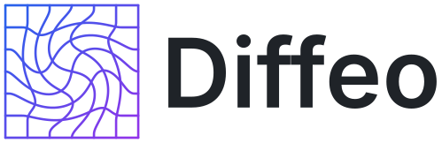

<p align="center">
  <picture>
    <source media="(prefers-color-scheme: dark)" srcset="docs/logo-dark.svg">
    
  </picture>
</p>

<p align="center">
  <strong>Compile-time safe tensor operations</strong>
</p>

<p align="center">
  
  
  <a href="https://github.com/romeric/Fastor"></a>
</p>

<br>

<p align="center">
  <picture>
    <source media="(prefers-color-scheme: dark)" srcset="docs/metric-dark.svg">
    
  </picture>
</p>

<p align="center">
  <a href="#overview">Overview</a> &nbsp;·&nbsp;
  <a href="#getting-started">Getting started</a> &nbsp;·&nbsp;
  <a href="#guide">Guide</a>
</p>

---

# Overview

The library provides an ecosystem for performing tensor operations in general-relativistic environments. It relies on [Fastor](https://github.com/romeric/Fastor) for optimizing tensor-network operations, allowing users to write tensor products naturally in a single line, while achieving maximum performance without hand-written kernels. `Diffeo` wraps a `Fastor::Tensor` in a `geom::Tensor` with explicitly defined lower or upper indices, so that a contraction `co_v(mu) = g(mu, nu) * v(nu);` only compiles if it obeys the Einstein summation rules.

Additionally, `Diffeo` provides tools for defining coordinate systems, transformation Jacobian matrices and metric tensors, all wrapped in `C++` classes and functions that only allow mathematically valid tensor operations at compile time. It is the user's responsibility to define the various mathematical expressions correctly.

# Getting started

Clone the repository and pull its dependencies:

```sh
git clone --recurse-submodules https://github.com/phyzan/diffeo
```

This is a header-only library, so there is nothing to build. In an external project, simply link `Diffeo`:

```cmake
add_subdirectory(path/to/diffeo)
target_link_libraries(your_target PRIVATE diffeo::diffeo)
```

# Guide

The snippets below assume

```cpp
#include <diffeo/metric/metric_tensor.hpp> // tensors, coordinates and metrics
using namespace geom;
```

## Coordinate systems

Define a coordinate system and optionally specialize the set of coordinates:

```cpp
struct Cartesian2D : BaseCoordSys<2> {};

// Template-specialization for Coordinates<Cartesian2D, T>.
// Not necessary, but allows for naming each coordinate
template<typename T>
struct Coordinates<Cartesian2D, T> : BaseCoordinates<Cartesian2D, T>{
    T& x() {return this->data[0];}
    T& y() {return this->data[1];}
    const T& x() const {return this->data[0];}
    const T& y() const {return this->data[1];}
};
```

`Cylindrical2D` is defined the same way, with `rho()` and `phi()`.

You can define the coordinate transformation rule between 2 sets of coordinates by properly overloading `get_coords`:

```cpp
template<typename T>
void get_coords(Coordinates<Cartesian2D, T>& x_cart, const Coordinates<Cylindrical2D, T>& x_cyl){
    // sets (x, y) given (rho, phi)
    x_cart.x() = x_cyl.rho() * cos(x_cyl.phi());
    x_cart.y() = x_cyl.rho() * sin(x_cyl.phi());
}

template<typename T>
void get_coords(Coordinates<Cylindrical2D, T>& x_cyl, const Coordinates<Cartesian2D, T>& x_cart){
    // sets (rho, phi) given (x, y)
    ...
}
```

Use the Jacobian matrix that describes the coordinate transformation between two sets of coordinates.
Its last two template parameters are simply the coordinate labels, empty simple structs.
It is a `NDIM x NDIM` matrix with compile-time index types $J^{\mu}_{\,\,\,\nu}$:

```cpp
Jacobian<ScalarType, Cartesian2D, Cylindrical2D>; // J(mu, nu) = J^mu_nu = d_cartesian^mu / dx_cylindrical^nu
```

Fill its values by passing it into the properly overloaded `get_dxdX` function. Schematically, this is

```cpp
get_dxdX(Jac& dxA_dxB, const BCoordSystem& xB) // Fill dx/dx', given x'
```

More concretely:

```cpp
template<typename T>
void get_dxdX(Jacobian<T, Cartesian2D, Cylindrical2D>& jac, const Coordinates<Cylindrical2D, T>& x_cyl){
    // `x_cyl` has the requested cylindrical coordinates (rho, phi)
    const T rho = x_cyl.rho();
    const T phi = x_cyl.phi();

    jac(0, 0) = cos(phi);       // dx/drho
    jac(0, 1) = -rho*sin(phi);  // dx/dphi
    jac(1, 0) = sin(phi);       // dy/drho
    jac(1, 1) = rho*cos(phi);   // dy/dphi
}
```

`x.dXdx<OtherSys>()` calls the matching `get_dxdX` at `x`:

```cpp
Coordinates<Cylindrical2D, double> x_cyl{2.0, 0.5}; // (rho, phi)
Coordinates<Cartesian2D, double> x_cart;
get_coords(x_cart, x_cyl);

auto jac = x_cyl.dXdx<Cartesian2D>(); // Jacobian<double, Cartesian2D, Cylindrical2D>
auto jac_inv = jac.inv();             // Jacobian<double, Cylindrical2D, Cartesian2D>
```

## Metric

A metric derives from `BaseMetric<Derived, T, CoordSys>` and only has to provide $g_{\mu\nu}(x)$ in its own coordinate system:

```cpp
template<typename T>
struct Euclidean2D : BaseMetric<Euclidean2D<T>, T, Cartesian2D>{

    // The fill_gcov below hides the base overloads, including the transforming one
    using BaseMetric<Euclidean2D<T>, T, Cartesian2D>::fill_gcov;

    void fill_gcov(MetricTensor<T, Cartesian2D>& g, const Coordinates<Cartesian2D, T>&) const {
        g(0, 0) = 1; g(0, 1) = 0;
        g(1, 0) = 0; g(1, 1) = 1;
    }
};
```

`MetricTensor<T, CoordSys>` is $g_{\mu\nu}$ and `InverseMetricTensor<T, CoordSys>` is $g^{\mu\nu}$, each tied to its coordinate system. The base class provides the rest, and any of it can be overridden with a closed form (as `adm::KerrBL3D` does):

```cpp
Euclidean2D<double> metric;

MetricTensor<double, Cartesian2D> g;
InverseMetricTensor<double, Cartesian2D> g_inv;
metric.fill_gcov(g, x_cart);
metric.fill_gcont(g_inv, x_cart);         // LU inverse of fill_gcov
double sqrt_g = metric.sqrt_gdet(x_cart); // sqrt|det g|
```

## Transforming the metric

$g'_{\mu\nu} = J^{\alpha}_{\,\,\,\mu} J^{\beta}_{\,\,\,\nu}\, g_{\alpha\beta}$, with $J = \partial x / \partial x'$:

```cpp
MetricTensor<double, Cylindrical2D> g_cyl;
metric.fill_gcov(g_cyl, jac, x_cart); // diag(1, rho^2)
```

The Jacobian must go from the metric's coordinate system to that of the output, and the point must be given in the metric's coordinates. Anything else doesn't compile:

```cpp
metric.fill_gcov(g_cyl, jac_inv, x_cart); // error: jac_inv transforms from Cylindrical2D to Cartesian2D
metric.fill_gcov(g, jac, x_cart);         // error: g is in Cartesian2D, jac transforms to Cylindrical2D
metric.fill_gcov(g_cyl, jac, x_cyl);      // error: the metric takes Cartesian2D coordinates
```

## Tensor operations

Indices are labeled with `Idx<id>` objects, where any distinct ids work (`MU, NU, I, J, K` are predefined). A label that appears once up and once down is summed over, and the free indices of the right hand side must match those of the assigned tensor, in position (up or down) and range:

```cpp
const Idx<MU> mu; const Idx<NU> nu; const Idx<I> i; const Idx<J> j;

// g'^{mu nu} = (dx'^mu/dx^i) (dx'^nu/dx^j) g^{ij}
InverseMetricTensor<double, Cylindrical2D> g_inv_cyl;
g_inv_cyl(mu, nu) = jac_inv(mu, i) * jac_inv(nu, j) * g_inv(i, j);

Vector<double, 2> v; // v^mu = (v^rho, v^phi)
v(0) = 1; v(1) = 0.25;

CoVector<double, 2> v_dn;
v_dn(mu) = g_cyl(mu, nu) * v(nu);     // lower the index
Vector<double, 2> w;
w(mu) = g_inv_cyl(mu, nu) * v_dn(nu); // raise it again: w == v

double v2 = v_dn(mu) * v(mu);         // no free indices, so a number: 1.25

Operator<double, 2> delta;
delta(mu, nu) = g_inv_cyl(mu, i) * g_cyl(i, nu); // the identity
```

Operations that break the summation rules don't compile:

```cpp
v(mu) = g_cyl(mu, nu) * v(nu); // error: the right hand side has a lower index
double s = v(mu) * v(mu);      // error: mu is up in both factors
```

Inside an index expression, metrics and Jacobians are plain tensors: the index positions and ranges are checked, but not the coordinate systems. In the future, tensors should also carry the coordinate system in which they are expressed, as a template parameter.